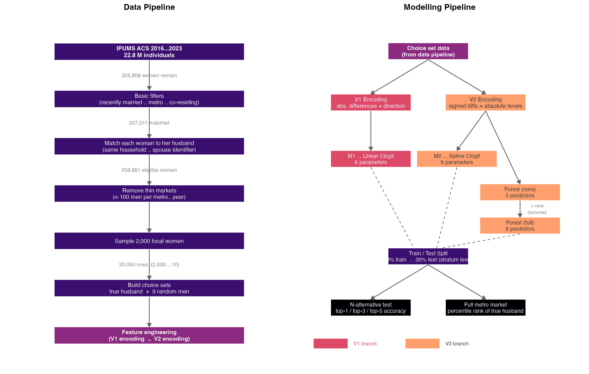
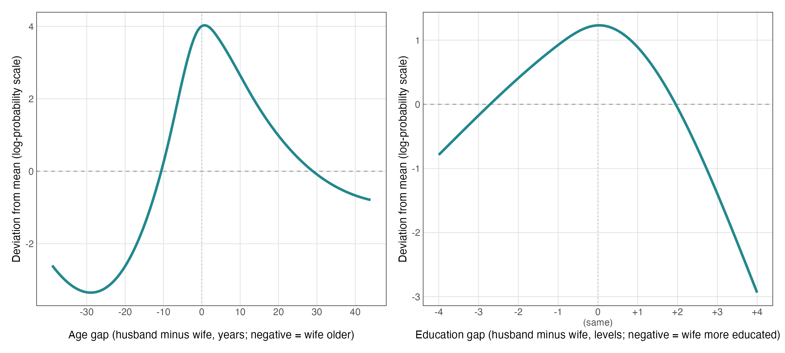
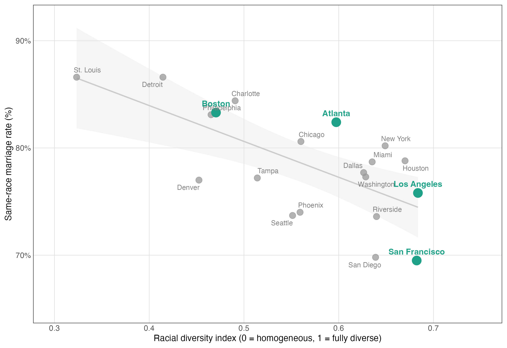

# How Predictable is Love? Machine Learning meets Partner Choice

**Master's thesis · Aleksandra Bocheva · MSc Computational Social Science, Linköping University, 2026**
Supervisor: Benjamin Jarvis · Co-supervisor: Jesper Lindmarker · Examiner: Sabrina Mai

📄 **[Read the thesis (PDF)](thesis/Bocheva_2026_How_Predictable_is_Love.pdf)** · 🌐 Interactive walkthrough: [aleksandrabocheva.github.io](https://aleksandrabocheva.github.io)

---

## The question

Who marries whom is one of the most studied questions in sociology, but most work describes population-level patterns. This thesis treats
assortative mating as a **prediction problem**: given a woman's sociodemographic profile and the pool of eligible men in her metropolitan
area, can a statistical model identify the man she actually married?

## Approach

- **Data:** American Community Survey 2016–2023 via [IPUMS USA](https://usa.ipums.org/usa/); married couples in four US metros
  (Los Angeles, Atlanta, Boston, San Francisco) in two periods (2016–17 and 2022–23).
- **Choice sets:** each woman is scored against every eligible man in her metro and year (and against 10-option sampled choice sets).
- **Models**, using only age, education and race:
  1. linear conditional logit (the standard benchmark in matching research),
  2. natural-spline conditional logit (9 parameters),
  3. conditional-logit forest (non-parametric benchmark, [CLogitTree](https://doi.org/10.1002/sim.9637)).
- **Explanation:** ablation study and forest permutation importance.



## Main findings

- All models far outperform chance: the true husband ranks in roughly the **top 14–15% of all eligible men** in his metro.
  In 10-option choice sets the top prediction is correct **~49% of the time vs. 10% by chance**.
- **The 9-parameter spline model matches or beats the forest in 7 of 8 metro × period comparisons.** The forest's advantage over the
  linear model comes from *functional form* (non-linear age and education preferences), not from complex interactions.
- This pattern fits the compensatory-utility view of exchange theory better than the categorical thresholds implied by boundary theory.
- The ablation study shows that a predictor's discriminative power depends not only on its coefficient but on the variance structure of
  the population it operates on.
- Machine learning benchmarks work best here as **specification diagnostics** for interpretable models, not as black-box replacements.

| | |
|---|---|
|  |  |

## Repository structure

```
pipeline/      Core data → model → evaluation pipeline (sourced by every experiment)
experiments/   Scripts that produce every figure and table in the thesis
discovery/     Exploratory scripts that informed design choices (scaling, stratified models)
results/       Aggregate result tables (CSV) behind the thesis tables
figures/       Thesis figures
thesis/        Final thesis PDF
```

All scripts run from the repository root, e.g. `Rscript experiments/metro_year.R`.

| Script | Thesis output |
|---|---|
| `pipeline/run_pipe.R` | End-to-end run: data → four models → top-k accuracy and metro percentile rank |
| `experiments/metro_year.R` | Table 3: 4 metros × 2 periods |
| `experiments/04_spec_comparison.R` | Table 2: linear → quadratic → spline vs. forest |
| `experiments/gen_ablation_h3.R` | Table 4: predictor ablation |
| `experiments/get_varimp.R` | Appendix Table A1: forest permutation importance |
| `experiments/run_large_test.R` | Appendix Table A2: 10,000-woman held-out test |
| `experiments/gen_fig_*.R` | Figures 1–7 and appendix figures |

## Software and acknowledgements

- R ≥ 4.4 with `tidyverse`, `survival`, `splines`, `ipumsr`, `patchwork`, `viridis`, `ggrepel`, `broom`, `scales`.
- **[fastclogit](https://github.com/jeppelina/fastclogit)** by **Jesper Lindmarker**: a memory-efficient conditional logit estimator
  written in C++ (Rcpp/RcppArmadillo). Its fast log-likelihood routine powers split selection in a modified version of CLogitTree, which
  made fitting conditional-logit forests at census scale feasible. Without it, the pipeline would not have run
  at the required scale.
- **CLogitTree** by Gunther Schauberger and Moritz Berger, in the modified version (lean memory mode, fastclogit backend, per-tree
  timeouts) maintained in Jesper Lindmarker's
  [ML-partner-choice-prediction](https://github.com/jeppelina/ML-partner-choice-prediction) repository, on which this pipeline builds.

```r
# fastclogit (Jesper Lindmarker)
remotes::install_github("jeppelina/fastclogit")
# modified CLogitTree with the fastclogit backend
remotes::install_github("jeppelina/ML-partner-choice-prediction", subdir = "packages/CLogitTree")
```

## Data

The IPUMS microdata are not redistributed here (IPUMS terms of use). To reproduce, request an IPUMS USA extract and save it as
`data/usa_00008.dat.gz` + `data/usa_00008.xml`:

- **Samples:** ACS 2016–2023
- **Variables:** AGE, SEX, RACE, HISPAN, EDUC, MARST, SPLOC, SERIAL, PERNUM, MET2013, YRMARR
- **Format:** `.dat.gz` with DDI codebook (`.xml`)

Please cite IPUMS USA as described in the [IPUMS citation guidelines](https://usa.ipums.org/usa/cite.shtml).

## Citation

```bibtex
@mastersthesis{bocheva2026love,
  author = {Bocheva, Aleksandra},
  title  = {How Predictable is Love? Machine Learning meets Partner Choice},
  school = {Link{\"o}ping University},
  year   = {2026},
  note   = {LIU-IEI-FIL-A--26/05270--SE}
}
```

## License

Code: MIT (see `LICENSE`). Thesis text and figures © Aleksandra Bocheva, 2026.
